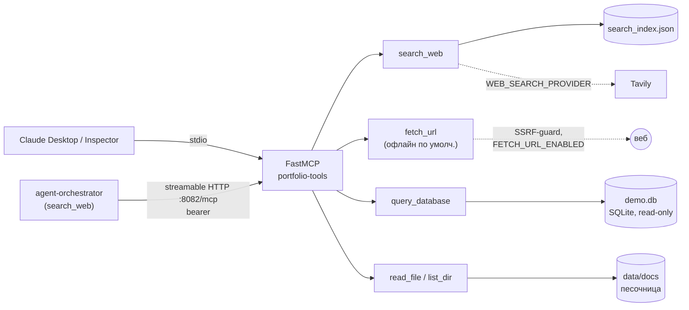
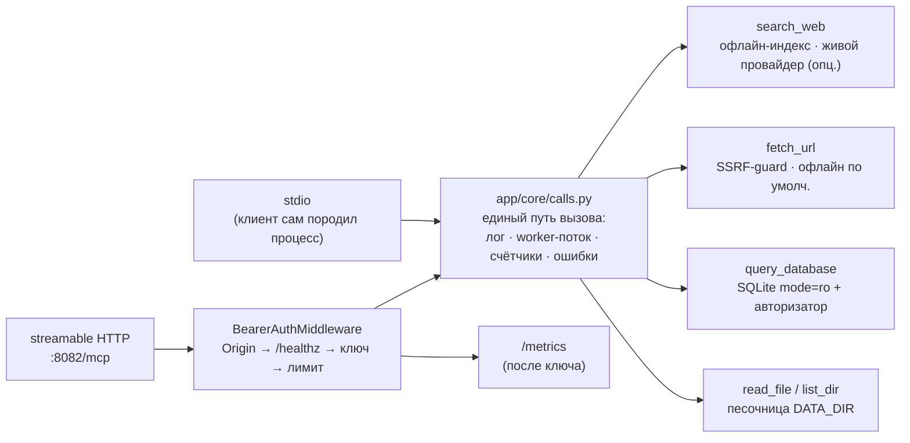

# mcp-tools-server

> Исходный код проекта закрыт — здесь его описание: архитектура, решения и результаты. Код покажу по запросу: Telegram [@interpol2121](https://t.me/interpol2121).

MCP-сервер на официальном Python SDK (FastMCP): четыре инструмента, два
транспорта (stdio и streamable HTTP) из одной кодовой базы, read-only SQL,
файловая песочница, полностью офлайновый набор тестов. Описания инструментов
и схемы аргументов — это интерфейс, над которым рассуждает модель, поэтому
они несут схему базы, примеры и ограничения намеренно.

## Место в платформе



Исследовательский агент платформы ходит сюда за веб-поиском по HTTP с
bearer-ключом; Claude Desktop подключается по stdio.

## Запуск всей платформы

Вся платформа — четыре бэкенда, консоль, Postgres и Redis — поднимается одной
командой из соседнего репозитория
[llm-platform-console](https://github.com/INTERpol21/llm-platform-console),
который держит зонтичный `docker-compose.yml`. Пять репозиториев должны лежать
рядом в одной папке:

```bash
cd ../llm-platform-console
cp .env.example .env
docker compose up --build     # консоль на http://localhost:8080
```

Всё работает офлайн на мок-моделях без единого API-ключа; ключ авторизации по
умолчанию — `demo-key`. Главный план сборки, схема платформы и экскурсия — в
README консоли.

## Быстрый старт (этот сервис отдельно)

```bash
make install-dev    # uv sync --frozen: рантайм + dev-зависимости (pytest, ruff, mypy)
make run-stdio      # stdio (по умолчанию) — для клиентов, порождающих сервер
make run-http       # streamable HTTP на :8082/mcp
# или: docker compose up --build
```

`make install` ставит только рантайм — для запуска хватит, но тесты и линтеры
не поедут. Остальные цели Makefile: `make seed` — явный посев демо-базы
(иначе она посеется лениво при первом `query_database`), `make format` —
применить форматтер (`make lint` только проверяет), `make lock` —
перегенерировать `uv.lock` и экспортированные `requirements*.txt` после любой
правки зависимостей в `pyproject.toml`.

Отладка: `npx @modelcontextprotocol/inspector python -m app.server`.

## Инструменты

| Инструмент | Аргументы | Возвращает |
|---|---|---|
| `search_web` | `query`, `max_results=5`, `offline_only=false` | Ранжированные `{title, url, snippet, score, published_at}` — от живого провайдера (если его настроил оператор) или из офлайн-индекса; на уровне ответа `source` (кто ответил), `fallback_reason` (почему ответил индекс) и `fetched_at` |
| `fetch_url` | `url`, `allowed_domains=null` | Извлечённый читаемый текст страницы `{url, final_url, title, content_type, text, truncated}` — под SSRF-защитой; **офлайн по умолчанию** (см. ниже) |
| `query_database` | `sql`, `max_rows=50` | `{columns, rows, row_count, truncated}` — один SELECT к демо-базе |
| `read_file` | `path` | UTF-8 содержимое файла из песочницы, до 100 КБ |
| `list_dir` | `path="."` | Отсортированные записи с типом и размером |

Все пять объявляют TypedDict-результаты, так что ответы уходят и как
`structuredContent` со схемой. Файлы из `data/docs/` опубликованы ещё и как
MCP-ресурсы `docs://<file>`; их чтение идёт через ту же песочницу и лимиты,
что и `read_file`.

Демо-база (сеется при первом запросе, ~25 строк о рынке вакансий):
`companies(id, name, industry, city)`,
`vacancies(id, company_id, title, grade, salary_rub, stack)`,
`applications(id, vacancy_id, applied_at, status)`.

`fetch_url` — **офлайн по умолчанию** (как и весь сервер): без
`FETCH_URL_ENABLED=1` инструмент зарегистрирован и виден, но каждый вызов
отклоняется — демо и смоук в сеть не ходят. Листинг говорит об этом сам: у
`fetch_url` в `tools/list` есть `_meta["portfolio-tools/enabled"]` — настоящий
JSON-boolean, равный `FETCH_URL_ENABLED` (у остальных инструментов этого ключа
нет). По нему каталог инструментов оркестратора (`GET /v1/agent/tools`)
отличает выключенный `fetch_url` от рабочего. Включённый, инструмент ходит
наружу только под сетевой песочницей — аналог файловой: сначала резолв хоста,
потом отказ на приватных/loopback/link-local/cloud-metadata-адресах
(проверяется **каждый**
хоп редиректа, так что редирект на внутренний адрес блокируется, а не
следуется); http/https-схемы, кап тела (стрим с обрывом), лимит редиректов,
короткий таймаут. Отказ SSRF говорит «blocked», не раскрывая резолвленный IP.
Необязательный `allowed_domains` — egress-список вызывающего (так оркестратор
передаёт свой `ORCH_AGENT_FETCH_EGRESS_DOMAINS`): он только **сужает**
серверный `FETCH_ALLOWED_DOMAINS` и никогда не расширяет его; списки без общего
домена — отказ.

## Как это устроено



- **Транспорты.** Один и тот же сервер работает по stdio (для клиентов,
  порождающих процесс, — Claude Desktop, Inspector) и по streamable HTTP на
  `:8082/mcp`. stdio не гейтится: его клиент и так владеет процессом.
- **HTTP-гейт.** Каждый HTTP-запрос проходит `BearerAuthMiddleware` в строгом
  порядке: валидация `Origin` (403 до всего остального — защита от DNS
  rebinding), `GET /healthz` (liveness без ключа), bearer-ключ
  (constant-time-сравнение со всеми ключами), пер-ключевой rate-limit
  (429 + `Retry-After`). `GET /metrics` отвечает **после** проверки ключа:
  «жив ли сервер» — не секрет, а частота отказов и латентности инструментов —
  операционная деталь, которую анонимному клиенту читать незачем.
- **Единый путь вызова.** Каждое тело инструмента и каждое чтение `docs://`
  идёт через `app/core/calls.py`: лог формы вызова, оффлоад в worker-поток
  (синхронное тело не морозит event loop и `/healthz`), счётчики исходов и
  латентности — и машинный контракт ошибок: любое исключение, кроме
  `ToolError`, доходит до клиента одной строкой «инструмент + класс
  исключения», без путей и трейсбеков; полная ошибка остаётся в серверном
  логе.
- **Чистые функции инструментов.** `search_web` ранжирует офлайн-индекс
  детерминированно, а при `WEB_SEARCH_PROVIDER=tavily` спрашивает живого
  провайдера через тот же egress-гард, что у `fetch_url`, и падает обратно на
  индекс, называя причину; `fetch_url` ходит наружу под сетевой песочницей (резолв
  хоста → отказ на приватных/loopback/link-local/metadata-адресах, каждый хоп
  редиректа; офлайн по умолчанию) — тот же дух «резолв до проверки», что и у
  файловой; `query_database` открывает SQLite строго read-only
  (`mode=ro` URI) с allow-list-авторизатором (только
  SELECT/READ/FUNCTION/RECURSIVE — записи, DDL, PRAGMA и ATTACH отвергаются
  движком); `read_file` / `list_dir` живут в песочнице `DATA_DIR` — путь
  сначала полностью резолвится (`resolve()`: симлинки и `..`), потом
  проверяется принадлежность корню, а симлинки, ведущие наружу, скрываются и
  из листинга.

Операционные эндпоинты HTTP-транспорта: `GET /healthz` — liveness без ключа
(отвечает middleware до гейта, его же опрашивает Docker-healthcheck);
`GET /metrics` — Prometheus-текст (`mcp_tool_calls_total{tool,outcome}`, где
`outcome` — `ok` / `rejected` (отказ) / `failed` (краш) / `cancelled` (клиент
ушёл до ответа), и `mcp_tool_duration_seconds_total{tool}`; для живого поиска —
`mcp_web_search_calls_total{provider,outcome}`, где `outcome` — `ok` или одна
из причин фолбэка, и `mcp_web_search_provider_duration_seconds_total{provider}`
— время только сетевого запроса) — только с ключом.

## Claude Desktop

Добавь в `claude_desktop_config.json`
(macOS: `~/Library/Application Support/Claude/`, Windows: `%APPDATA%\Claude\`),
перезапусти — пять инструментов появятся в новом чате:

```json
{
  "mcpServers": {
    "portfolio-tools": {
      "command": "python",
      "args": ["-m", "app.server", "--transport", "stdio"],
      "env": {
        "PYTHONPATH": "/абсолютный/путь/к/mcp-tools-server",
        "DATA_DIR": "/абсолютный/путь/к/mcp-tools-server/data"
      }
    }
  }
}
```

Claude Desktop не задаёт серверам рабочую директорию, поэтому оба пути должны
быть абсолютными; если зависимости в venv — укажи его интерпретатор в
`command`.

## Конфигурация

Читается из окружения процесса; полный список с комментариями — в
`.env.example`.

| Переменная | По умолчанию | Зачем |
|---|---|---|
| `DATA_DIR` | `./data` | Корень песочницы с `search_index.json`, `demo.db` и `docs/` |
| `MCP_HOST` / `MCP_PORT` | `127.0.0.1` / `8082` | Адрес HTTP-транспорта — по умолчанию только loopback; Dockerfile и compose-файлы явно ставят `MCP_HOST=0.0.0.0`, потому что внутри контейнера это корректно |
| `MCP_API_KEYS` | `demo-key` | Bearer-ключи HTTP-транспорта через запятую (stdio не гейтится — его клиент и так породил процесс) |
| `MCP_ALLOWED_ORIGINS` | пусто | Браузерные `Origin`, которым разрешён HTTP-транспорт; пусто — строгий дефолт (ни один браузер не является легитимным клиентом). Схема и хост сравниваются регистронезависимо, порт — точно |
| `MCP_ALLOWED_HOSTS` | пусто | Заголовки `Host` для собственного анти-rebinding-гарда SDK (`host:port` или `host:*`); пусто — гард следует за `MCP_HOST` (loopback — включён, `0.0.0.0` — выключен); задан — гард включён с этим списком при любом бинде, чужой `Host` получает `421`. Standalone `docker-compose.yml` ставит `127.0.0.1:*,localhost:*,[::1]:*,host.docker.internal:*` |
| `MCP_RATE_LIMIT_RPM` | `120` | Вызовы инструментов в минуту на один ключ (`tools/call` и чтения `docs://`; служебные запросы сессии вокруг вызова — `server/discover`/`initialize`, `tools/list`, `DELETE` — бесплатны); сверх — `429` + `Retry-After`; `0` выключает лимит |
| `FETCH_URL_ENABLED` | `0` | Включает `fetch_url` (1/0/true/false/yes/no/on/off; кривое значение — ошибка старта); выключенный инструмент виден, но отказывает каждому вызову |
| `FETCH_URL_TIMEOUT_SECONDS` | `5` | ОБЩИЙ wall-clock бюджет одного вызова `fetch_url`: все хопы редиректа, DNS, соединение и каждое чтение тела делят его |
| `FETCH_URL_MAX_BYTES` | `2097152` | Кап тела ответа (2 МБ): стрим обрывается на капе, `truncated=true` |
| `FETCH_URL_MAX_REDIRECTS` | `5` | Лимит хопов редиректа; каждый хоп проходит SSRF-гард заново |
| `FETCH_ALLOWED_DOMAINS` | пусто | Необязательный allow-list доменов для `fetch_url` (через запятую): хост совпадает, если равен записи или её поддомен; пусто — выключен. Запись — голое доменное имя: `*.example.com`, URL или `host:port` — ошибка старта |
| `WEB_SEARCH_PROVIDER` | `offline` | Кто отвечает на `search_web`: `offline` (кураторский индекс, без сети) или `tavily` (живой веб; индекс — фолбэк). Регистр не важен; другое значение — ошибка старта |
| `WEB_SEARCH_API_KEY` | пусто | Ключ провайдера; обязателен при `WEB_SEARCH_PROVIDER≠offline` (8–256 печатных ASCII без пробелов, иначе ошибка старта). Только env: не логируется, не попадает в ошибки и в `repr` настроек; в офлайне игнорируется |
| `WEB_SEARCH_TIMEOUT_SECONDS` | `6` | ОБЩИЙ wall-clock бюджет одного вызова провайдера (DNS, соединение, TLS, весь ответ), `0 < x ≤ 30`. Своя ручка — намеренно не `FETCH_URL_TIMEOUT_SECONDS` |
| `WEB_SEARCH_FALLBACK_TO_INDEX` | `true` | При сбое провайдера (таймаут, 429, неверный ключ, кривой ответ, исчерпанный бюджет) ответить из офлайн-индекса и назвать причину в `fallback_reason`; `false` — отказ закрытым текстом |
| `WEB_SEARCH_MAX_REQUESTS_PER_MINUTE` | `30` | Потолок вызовов провайдера в минуту на процесс (ключ — один общий платный кред); сверх него, как и сверх 3 одновременных вызовов, — фолбэк с `budget_exhausted` без запроса. `0` — без потолка по частоте (кап одновременности остаётся) |
| `OTEL_ENABLED` | `0` | Трейсинг HTTP-транспорта (OpenTelemetry); выключен — no-op-трейсер |
| `OTEL_EXPORTER_OTLP_ENDPOINT` | пусто | OTLP/HTTP-эндпоинт коллектора; без него трейсинг выключен даже при `OTEL_ENABLED=1`. Токен — в стандартном `OTEL_EXPORTER_OTLP_HEADERS` |
| `OTEL_SERVICE_NAME` | `mcp-tools-server` | `service.name` спанов. Спан несёт только метод, шаблон маршрута, статус и длительность — никогда контент |

## Безопасность

- **Origin-валидация — до ключа, ответ 403.** Bearer-ключ не защищает от DNS
  rebinding: страница атакующего перерезолвивает своё имя в `127.0.0.1`, и
  браузер шлёт наш запрос со своими кредами — изнутри он выглядит
  same-origin. Спецификация MCP делает Origin-проверку MUST; запрос **без**
  Origin легитимен (его шлют только браузеры, а все легитимные клиенты здесь —
  сервисы). Важно: FastMCP выводит собственный анти-rebinding-гард из адреса
  бинда, и `MCP_HOST=0.0.0.0` молча его выключает — именно поэтому наша
  проверка живёт в middleware и от адреса не зависит. Где бинд обязан быть
  `0.0.0.0`, но все легитимные `Host` известны (standalone compose), гард SDK
  включается обратно явным списком `MCP_ALLOWED_HOSTS`.
- **Пер-ключевой бюджет вызовов.** «Rate limit tool invocations» — серверный
  MUST спецификации: `MCP_RATE_LIMIT_RPM` (fixed window на минуту, на ключ,
  `429` + `Retry-After`). Считаются именно вызовы инструментов, не
  HTTP-запросы: клиент открывает сессию на каждый вызов (так делает
  оркестратор — три запроса на вызов), и по запросам бюджет в 120 давал около
  40 вызовов. Middleware читает JSON-RPC-метод из тела; тело, которое не
  доказуемо служебное (не парсится, пакет с `tools/call`), тарифицируется. Лимитер ключуется дайджестом ключа
  (`sha256[:16]`), а не сырым ключом — живой кред не лежит ключом словаря на
  всю жизнь процесса.
- **Loopback по умолчанию.** Локальный `make run-http` слушает только
  `127.0.0.1` — публикация инструментов на всю сеть требует явного
  `MCP_HOST=0.0.0.0` (контейнеры так и делают, см. таблицу конфигурации).
  Бинд внутри контейнера и публикация на хосте — разные ручки: standalone
  `docker compose up` публикует порт только на `127.0.0.1:8082` хоста (как
  gateway и rag), а не на всех интерфейсах с общеизвестным демо-ключом, и
  держит Host-гард SDK включённым через `MCP_ALLOWED_HOSTS` (loopback-имена
  хоста и `host.docker.internal` — так его зовёт standalone-оркестратор).
- `query_database` — многослойная защита по принципу наименьших привилегий:
  read-only URI (`mode=ro`), авторизатор `sqlite3` с allowlist на
  SELECT/READ/FUNCTION (запрещены записи, DDL, PRAGMA, ATTACH и транзакции),
  отсечение многозапросных строк, лимиты на строки, ячейки и общий размер,
  дедлайн исполнения на уровне движка.
- `read_file` / `list_dir` — песочница `DATA_DIR`: абсолютные пути
  принимаются только если резолвятся внутрь корня; любой побег (`..`,
  симлинк наружу) отклоняется.
- `fetch_url` — сетевая песочница (SSRF-guard), сетевой аналог файловой:
  только http/https; хост резолвится и отклоняется на приватных/loopback/
  link-local/cloud-metadata-диапазонах (127/8, 10/8, 172.16/12, 192.168/16,
  169.254/16 включая 169.254.169.254, 0.0.0.0/8, `::1`, fc00::/7, fe80::/10);
  проверка — **после** DNS-резолва и на **каждом** хопе редиректа (защита от
  DNS-rebinding: редирект на внутренний адрес блокируется, а не следуется).
  Соединение пинится на провалидированный адрес, Host/SNI несут имя. Отказ
  SSRF говорит «blocked» без раскрытия резолвленного IP. Офлайн по умолчанию
  (`FETCH_URL_ENABLED`), с капами на тело, редиректы и таймаут.
- **Живой поиск — второй egress-путь: включается явно, один фиксированный
  хост.** При `WEB_SEARCH_PROVIDER=tavily` `search_web` ходит ровно на
  `api.tavily.com` через те же примитивы, что и `fetch_url`: резолв, проверка
  каждого адреса SSRF-гардом, соединение пинится на провалидированный адрес,
  TLS проверяется, весь вызов — под одним wall-clock бюджетом, тело — до 1 МиБ.
  Редиректы не следуются (3xx — сбой), ретраев и прокси нет, переменной, которая
  перенаправила бы вызов на другой хост, нет намеренно. Он не зависит от
  `FETCH_URL_ENABLED` и не сужается `FETCH_ALLOWED_DOMAINS`, а найденный домен
  никогда не расширяет allow-list `fetch_url`. Текст провайдера чистится
  (управляющие символы, одиночные суррогаты, теги, капы длины), URL остаются
  только http(s), даты — `YYYY-MM-DD` или `null`.
- **Вызывающий может только сузить.** `offline_only=true` оставляет вызов на
  офлайн-индексе без запроса к провайдеру и без траты бюджета; выбрать
  провайдера, хост или включить живой поиск аргументом нельзя. Этим пользуется
  agent-orchestrator: пока в llm-gateway включено скрытие персональных данных
  (или его состояние не прочитать), он шлёт каждый `search_web` с
  `offline_only=true` — вопрос с восстановленными ПДн не уходит провайдеру.
  Запросы других MCP-клиентов уходят провайдеру как есть.
- Bearer на HTTP сравнивается за постоянное время с каждым ключом без
  досрочного выхода; кривой токен получает честный 401. Ключи MCP и ключ
  провайдера исключены из `repr` настроек.
- Структурные JSON-логи пишутся в stderr (stdout занят JSON-RPC-кадрами
  stdio) и содержат только формы и размеры вызовов — никогда данные.
- Любой сбой инструмента — это `ToolError` с одной понятной строкой:
  клиенты видят внятную ошибку, но не трейсбек и не серверные пути. Контракт
  держится машинно в едином пути вызова (`app/core/calls.py`), а не памятью
  авторов инструментов.

`search_web` по умолчанию офлайн: детерминированное ранжирование по 14
кураторским записям, чтобы демо, CI и тесты были воспроизводимы и не ходили в
сеть. Оператор включает живой поиск (`WEB_SEARCH_PROVIDER=tavily` и ключ) — и
тот же инструмент с тем же контрактом отвечает настоящими результатами, а
индекс становится фолбэком. Кто ответил и почему — данные в ответе, а не
догадка:

| Поле | офлайн или `offline_only=true` | провайдер ответил | провайдер упал, фолбэк включён |
|---|---|---|---|
| `source` | `offline_index` | `tavily` | `offline_index` |
| `fallback_reason` | `null` | `null` | `timeout` / `rate_limited` / `auth_failed` / `upstream_error` / `bad_response` / `budget_exhausted` |
| `results[].score` | балл совпадения по ключевым словам | целое по рангу: `n − i` для i-го из n | балл совпадения |
| `total_matches` | записей с баллом > 0 | число результатов | как в офлайне |
| `published_at` | значение из индекса | `YYYY-MM-DD` или `null` | значение из индекса |
| `fetched_at` | момент чтения индекса | момент чтения ответа провайдера | момент чтения индекса |

С `WEB_SEARCH_FALLBACK_TO_INDEX=false` сбой провайдера — отказ
(`isError`) закрытым текстом с причиной и без единого слова из ответа
провайдера. `score` сравним только внутри одного ответа. `fallback_reason`
обязателен и nullable (как `published_at`): явный `null` отличает «ответил
настроенный источник» от «сервер старый и поля не знает». Каждый результат
несёт `published_at` (ISO-дата или явный `null` для недатируемых страниц);
клиенты обязаны считать `published_at` опциональным.

## Тесты и гейты

```bash
make test        # полностью офлайн: юниты, конкуренция, MCP-клиент в памяти
make lint && make typecheck
make cov         # покрытие тем же набором, что make test: coverage/{run.json,coverage.json,junit.xml,html/}; только цифры, без порога; ARGS="…" уходит в pytest и записывается в run.json (`args`)
```

Интеграционный ярус гоняет настоящего MCP-клиента через SDK и проверяет
схемы инструментов, `structuredContent`, ресурсы `docs://` и то, что ошибки
приходят как `isError` без трейсбеков. Отдельный ярус пинит правила
спецификации: порядок гейтов middleware, Origin-валидацию, лимитер и
loopback-дефолт. Контракт с потребителем (`tests/test_consumer_contract.py`)
пинит каждый аргумент, который шлёт оркестратор: `search_web.query` и
`max_results` (без `maximum` ниже 20 — `WEB_MAX_RESULTS` оркестратора
допускает до 20), `query_database.sql`, `fetch_url.url` и `allowed_domains` —
имена, типы и обязательность, плюс флаг `_meta` у `fetch_url` и
`search_web.offline_only` (гейт приватности оркестратора). SDK молча
отбрасывает незнакомый аргумент, так что переименование иначе прошло бы без
единой ошибки.

Живой поиск тестируется без сети. Адаптер, маппинг сбоев в причины, бюджеты,
чистка текста и логи — на фейковом транспорте; настоящий транспорт —
на loopback-«хостах» в потоке того же процесса, по HTTP **и по TLS** с
одноразовым сертификатом на тест (`tests/test_search_provider_socket_transport.py`,
общие хосты — `tests/loopback_hosts.py`): заголовки запроса, дошедшие до хоста
(ключ — только в `Authorization`), бюджет на медленный ответ, зависший
хендшейк, отказ недоверенному сертификату, кап тела, возврат редиректа без
перехода. Автоматический гард в `conftest.py` валит любой тест, дошедший до
настоящего транспорта без явного разрешения. Настоящий контракт провайдера
(коды статусов, форма тела, даты) проверяется только вживую — с ключом
владельца в локальном `.env`.

CI: ruff (check + format), mypy strict, pytest, дрейф-чек экспорта
зависимостей, pip-audit, bandit. Гейт pytest жёсткий: **любой skip валит
сборку** — каждый skip-гард в наборе существует для окружения, которым
CI-раннер не является, поэтому честное число скипов там ноль, а «тихо
скипнувшийся» контрактный тест не может спрятаться за зелёной сборкой.
Этот же единственный прогон — `make cov`: в сводку задания идут строки и
ветвления, а `coverage/` уходит артефактом `coverage-mcp-tools-server`.
Порога покрытия нет намеренно — это цифра, а не гейт.
`coverage/run.json` пишется только после зелёного прогона (красный pytest
валит и сам `make cov`): в нём коммит, чистота дерева до и после прогона,
отбор тестов (`args`: `PYTEST_ADDOPTS`, затем `ARGS`) и sha256 обоих отчётов.
Суженный прогон (путь, `-k`, `-m`) виден по `args`, так что за цифру набора
CI он не сойдёт.

## Документация

- AGENTS.md — правила для кодовых агентов: порядок чтения,
  обязательные гейты, что здесь легко сломать.
- CLAUDE.md — глубокий разбор кода: карта модулей, инварианты,
  ловушки, тестовая стратегия.
- CONTRIBUTING.md — настройка окружения, гейты и
  конвенции для людей.
- Архитектурные решения платформы — ADR в консоли:
  docs/adr
  (полирепо и контракты, единый Postgres, безопасность границ).

## Релизы

История версий — в CHANGELOG.md. Бамп версии в `main` — это
релиз: workflow ставит тег и публикует запись с текстом из CHANGELOG.
